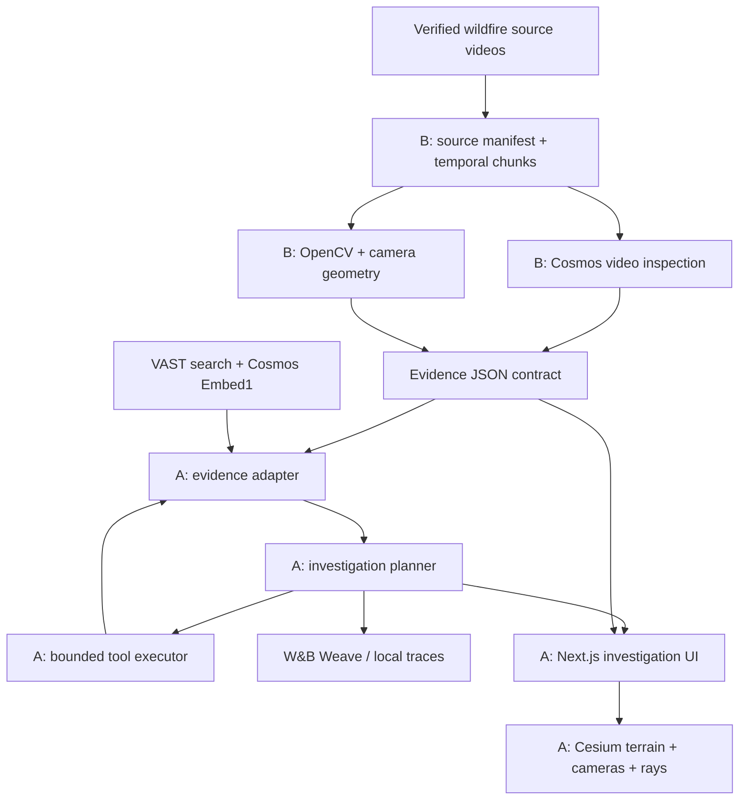

# Architecture and responsibilities

## Integration principles
- B emits **structured evidence**, not UI components or arbitrary prose.
- A consumes a stable API and never imports B's OpenCV modules directly.
- All IDs are stable: `incident_id`, `camera_id`, `video_id`, `segment_id`, `evidence_id`.
- Times use UTC ISO 8601 for wall clock and seconds for video-local playback; mapping must be explicit.
- Camera bearings are geodetic degrees clockwise from true north; elevations in metres; angles may be null.
- Spatial claims include `geometry_status`: `verified`, `estimated`, or `unavailable`.
- Agent tools are bounded by a whitelist and a maximum action budget; errors become structured observations.

## Deployment
Single Next.js dev server and one FastAPI server; B may run preprocessing scripts independently. No GPU training. Cache model responses and prepared video assets for demo reliability. API origin configured by `NEXT_PUBLIC_API_BASE_URL`.
